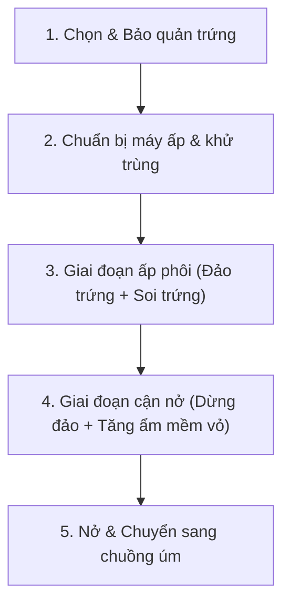

# CẨM NANG NGHIỆP VỤ ẤP TRỨNG GIA CẦM & THỦY CẦM
> **Dành cho người mới bắt đầu / Người không có chuyên môn nông nghiệp**  
> *Tài liệu giải thích dễ hiểu về nguyên lý sinh học, quy trình chuẩn từ chọn trứng đến khi nở, và lý do tại sao máy ấp trứng cần tự động điều chỉnh.*

---

## PHẦN 1: BẢN CHẤT CỦA VIỆC ẤP TRỨNG LÀ GÌ?

Nhiều người nghĩ ấp trứng chỉ đơn giản là "ủ cho nóng". Thực tế, **trứng có phôi là một sinh mệnh sống đang thở**:
1. **Vỏ trứng có hàng nghìn lỗ khí li ti:** Phôi hút khí Oxy ($O_2$) từ môi trường bên ngoài và thải khí Cacbonic ($CO_2$) và hơi nước ra ngoài qua vỏ.
2. **Nhiệt độ (37°C - 38°C):** Đóng vai trò như "nguồn năng lượng" để tế bào phôi phân chia, hình thành tim, mắt, xương và lông.
3. **Độ ẩm (55% - 75%):** Quyết định lượng nước bốc hơi trong trứng. Nếu khô quá, con non bị teo và dính chặt vào màng vỏ (sát vỏ); nếu ẩm quá, buồng khí không đủ lớn khiến con non bị ngạt thở khi mổ mỏ.
4. **Đảo trứng:** Giúp phôi không bị chìm xuống đáy và dính chặt vào màng trong của vỏ trứng (tránh chết phôi dính).

---

## PHẦN 2: BẢNG THÔNG SỐ VÀNG CHO 6 LOẠI TRỨNG PHỔ BIẾN

| Loại trứng | Tổng ngày ấp | Giai đoạn Ấp Phôi | Giai đoạn Cận Nở | Ngày chuyển khay nở | Nhiệt độ Ấp | Ẩm Ấp | Nhiệt độ Nở | Ẩm Nở |
| :--- | :---: | :---: | :---: | :---: | :---: | :---: | :---: | :---: |
| 🥚 **Gà ta / Gà nòi** | **21 ngày** | Ngày 1 - 18 | Ngày 19 - 21 | **Ngày 19** | 37.5°C | 60% | **37.0°C** | **70%** |
| 🦆 **Vịt cỏ / Vịt xiêm** | **28 ngày** | Ngày 1 - 24 | Ngày 25 - 28 | **Ngày 25** | 37.8°C | 65% | **37.1°C** | **75%** |
| 🐦 **Chim cút siêu trứng**| **17 ngày** | Ngày 1 - 14 | Ngày 15 - 17 | **Ngày 15** | 37.5°C | 55% | **37.0°C** | **65%** |
| 🕊️ **Bồ câu Pháp** | **18 ngày** | Ngày 1 - 15 | Ngày 16 - 18 | **Ngày 16** | 38.0°C | 58% | **37.3°C** | **68%** |
| 🪿 **Ngỗng sư tử** | **30 ngày** | Ngày 1 - 26 | Ngày 27 - 30 | **Ngày 27** | 37.7°C | 68% | **37.0°C** | **80%** |
| 🦚 **Chim trĩ đỏ** | **24 ngày** | Ngày 1 - 20 | Ngày 21 - 24 | **Ngày 21** | 37.6°C | 60% | **37.0°C** | **70%** |
| 🧪 **Chế độ Test** | **3 ngày** | Ngày 1 | Ngày 2 - 3 | **Ngày 2** | **27.0°C** | 60% | **28.0°C** | **65%** |

---

## PHẦN 3: VÙNG DUNG SAI NHIỆT ĐỘ SINH HỌC & BẢNG TỔNG KẾT BÁO ĐỘNG NÓNG / LẠNH

Nhiều người mới bắt đầu lầm tưởng rằng máy ấp phải giữ nhiệt độ "chết đinh đinh" ở một con số cố định (ví dụ chính xác 37.5°C không được lệch 0.1°C). Thực tế trong sinh học gia cầm:

### 1. Nguyên lý Vùng Đệm Nhiệt Sinh Học (Biological Thermal Buffer)
- **Dao động tự nhiên bình thường:** Trong quá trình ấp, nhiệt độ buồng ấp dao động trong dải $\pm 0.3^\circ\text{C}$ đến $\pm 0.5^\circ\text{C}$ quanh mức mục tiêu là hoàn toàn bình thường, phôi vẫn phát triển rất khỏe mạnh.
- **Quy luật sinh tử: "Chịu nóng KÉM, chịu lạnh RẤT GIỎI":**
  - **Quá nhiệt ($\ge \text{Target} + 0.8^\circ\text{C}$ hoặc $\ge 38.3^\circ\text{C}$ - NGUY HIỂM TÍNH MẠNG):** Phôi trứng chịu nhiệt cực kém. Vượt ngưỡng này chỉ vài tiếng sẽ làm protein trong trứng bị đông vón, phôi xuất huyết và chết hàng loạt. Vì vậy ngưỡng cảnh báo nóng bắt buộc phải **rất nhạy** ($+0.8^\circ\text{C}$) để cứu trứng kịp thời.
  - **Quá lạnh ($\le \text{Target} - 1.5^\circ\text{C}$ - Khoan dung hơn nhiều):** Phôi trứng chịu lạnh rất tốt. Khi nhiệt độ tụt, phôi chỉ tạm thời "ngủ đông" (làm chậm trao đổi chất). Khi ấm lại phôi sẽ phát triển tiếp, tối đa chỉ làm trễ ngày nở thêm nửa ngày chứ không chết ngay. Vì vậy ngưỡng báo lạnh được nới lỏng xuống ($-1.5^\circ\text{C}$) để người nuôi mở nắp châm nước, soi trứng không bị còi hú phiền toái.

### 2. Bảng Tổng Kết Dải Nhiệt Độ Sinh Học & Phản Ứng Của Hệ Thống

| Dải nhiệt độ thực tế | Trạng thái sinh học của phôi | Hành động của thiết bị | Trạng thái Còi báo |
| :--- | :--- | :--- | :--- |
| **$\ge \text{Target} + 0.8^\circ\text{C}$** *(hoặc $\ge 38.3^\circ\text{C}$)* | 🚨 **Quá nhiệt nguy cấp** *(Nguy cơ chết phôi tức thì)* | Cưỡng bức TẮT đèn sưởi, BẬT quạt tối đa để xả nhiệt | **Hú còi dồn dập** *(120ms liên tục)* |
| **$\text{Target} + 0.4^\circ\text{C} \rightarrow +0.7^\circ\text{C}$** | ⚠️ **Hơi ấm trên mức chuẩn** *(Cần điều hòa hạ bớt)* | Bật quạt gió nhẹ nhàng để thổi khí nóng ra ngoài | 🔇 **Còi TẮT** *(êm ái)* |
| **$\text{Target} - 0.2^\circ\text{C} \rightarrow +0.3^\circ\text{C}$** | 🟢 **VÙNG HOÀN HẢO (Lý tưởng)** *(Phôi phát triển tối ưu)* | Duy trì trạng thái cân bằng tự nhiên | 🔇 **Còi TẮT** *(êm ái)* |
| **$\text{Target} - 0.3^\circ\text{C} \rightarrow -1.4^\circ\text{C}$** | 🟡 **Hơi mát tạm thời** *(Khi mở nắp, thêm nước)* | Đèn sưởi tự động BẬT để nâng nhiệt bù lại | 🔇 **Còi TẮT** *(êm ái)* |
| **$\le \text{Target} - 1.5^\circ\text{C}$** *(hoặc $\le 36.0^\circ\text{C}$)* | ❄️ **Quá lạnh kéo dài** *(Đứt bóng sưởi, mất điện, hở nắp)* | Đèn sưởi kích hoạt công suất tối đa | **Bíp chậm 5 nhịp, nghỉ 30s** *(nhắc nhở người nuôi)* |

---

## PHẦN 4: TẠI SAO HỆ THỐNG PHẢI "HẠ NHIỆT & TĂNG ẨM" Ở CUỐI CHU KỲ?

Đây là bí quyết quan trọng nhất trong kỹ thuật ấp trứng nhân tạo mà người mới thường không biết:

### 1. Tại sao phải HẠ NHIỆT ĐỘ (từ 37.5°C xuống 37.0°C)?
- Trong 3 ngày cuối, con non đã hình thành đầy đủ các cơ quan nội tạng và bắt đầu đạp mạnh.
- Con non **tự tỏa ra một lượng thân nhiệt rất lớn**.
- Nếu máy ấp vẫn giữ nguyên nhiệt độ cao như ban đầu, con non sẽ bị sốc nhiệt, há mỏ thở dốc, khô nhớt và kiệt sức chết ngạt trước khi kịp đạp vỏ.

### 2. Tại sao phải TĂNG ĐỘ ẨM (từ 60% lên 70% - 75%)?
- Lớp vỏ trứng gia cầm cấu tạo từ canxi cứng.
- Khi tăng độ ẩm, hơi nước làm **mềm lớp vỏ vôi** và giữ cho lớp **màng nhầy bên trong vỏ không bị khô quắt lại**.
- Nếu thiếu ẩm ở giai đoạn này, khi con non mổ rách vỏ, không khí bên ngoài tràn vào làm màng vỏ khô đanh lại như keo, dính chặt vào lông con non (dân gian gọi là **"chết sát vỏ"**).

---

## PHẦN 5: QUY TRÌNH ẤP TRỨNG CHUẨN TỪ A ĐẾN Z

### Bước 1: Tuyển chọn trứng giống (Quyết định 50% tỷ lệ nở)
- **Phải có trống (có cồ):** Trứng mua ở siêu thị/chợ để ăn là trứng công nghiệp không có trống, không thể nở!
- **Độ tuổi của trứng:** Tốt nhất là trứng đẻ từ **3 - 7 ngày**. Trứng để quá 10 ngày tỷ lệ nở giảm đi một nửa.
- **Hình dáng & vệ sinh:** Chọn quả cân đối, không quá dài hoặc quá tròn. Vỏ lành lặn, không nứt. Lau bằng khăn khô sạch (tuyệt đối **không rửa bằng nước lạnh** vì làm bít lỗ khí và vi khuẩn xâm nhập).
- **Cách đặt trứng:** Luôn đặt **đầu to hướng lên trên**, đầu nhỏ hướng xuống dưới (vì buồng khí thở nằm ở đầu to).

### Bước 2: Chuẩn bị máy ấp
- Lau sạch thùng ấp bằng cồn 70° hoặc dung dịch khử trùng nhẹ.
- Đổ nước sạch vào khay tạo ẩm dưới đáy máy.
- Cắm điện cho máy chạy thử **2 - 3 tiếng** để nhiệt độ và độ ẩm ổn định ở mức 37.5°C trước khi cho trứng vào.

### Bước 3: Giai đoạn ấp phôi (Từ ngày 1 đến ngày chuyển nở)
- **Đảo trứng:** Đảo nghiêng 45° hoặc lăn trứng mỗi 2 - 4 tiếng một lần (nếu máy có khay đảo tự động hoặc dùng tay lăn nhẹ).
- **Soi trứng (Dùng đèn pin điện thoại áp sát vào đầu to):**
  - **Lần 1 (Ngày thứ 6 - 7):** Trứng tốt sẽ thấy một chấm đỏ (tim phôi) tỏa ra các tia máu đỏ li ti như **mạng nhện**. Nếu trứng trong suốt $\rightarrow$ Trứng không cồ, loại ra để ăn. Nếu thấy vệt máu loãng hoặc vòng tròn máu sát vỏ $\rightarrow$ Phôi đã chết sớm, loại bỏ ngay.
  - **Lần 2 (Ngày thứ 14):** Bên trong đen kín gần hết quả trứng, buồng khí ở đầu to rõ ràng và phôi chuyển động bên trong.

### Bước 4: Giai đoạn cận nở (3 ngày cuối cùng)
- **DỪNG ĐẢO TRỨNG:** Lấy trứng ra khỏi khay đảo, xếp nằm ngang trên một lớp vải hoặc lưới phẳng (gọi là khay nở) để con non định hình vị trí mổ vỏ.
- Hệ thống máy sẽ **tự động hạ nhiệt và tăng ẩm**.
- Người dùng chỉ cần kiểm tra khay nước xem có cạn không để châm thêm.

### Bước 5: Khi trứng bắt đầu mổ mỏ & nở
- Con non sẽ dùng "răng vỏ" trên đầu mỏ để gõ nứt vỏ một vòng tròn rồi dùng chân đạp tung nắp vỏ ra ngoài.
- **Nguyên tắc vàng:** **Không can thiệp bóc vỏ sớm!** Mạch máu rốn của gà non chưa kịp co lại, bóc sớm sẽ làm gà bị chảy máu rốn chết. Chỉ hỗ trợ bóc nhẹ sau khi gà đã mổ mỏ hơn 12 tiếng mà chưa tự đạp ra được.
- Để gà non nằm trong máy ấp **4 - 6 tiếng** cho đến khi khô lông hoàn toàn, lông xù bông lên thì mới bắt ra chuồng úm có đèn sưởi.

---

## PHẦN 6: CHẨN ĐOÁN CÁC HIỆN TƯỢNG BẤT THƯỜNG (TROUBLESHOOTING)

| Hiện tượng xảy ra | Nguyên nhân chính | Cách xử lý cho lứa sau |
| :--- | :--- | :--- |
| **Soi ngày 7 thấy trứng trong suốt, không có tia máu** | Trứng không có trống (gà/vịt trống kém hoặc không đạp mái). | Thay đổi tỷ lệ trống/mái ở chuồng nuôi (1 trống : 6-8 mái). |
| **Phôi chết nhiều ở ngày 1 - 5** | Trứng giống để quá lâu (> 10 ngày) hoặc nhiệt độ buồng ấp bị vọt quá cao (> 38.5°C). | Dùng trứng mới đẻ trong vòng 5 ngày; kiểm tra quạt xả nhiệt của máy. |
| **Gà mổ mỏ nhưng chết ngạt trong trứng, màng dính chặt vào lông** | **Thiếu độ ẩm trầm trọng** ở 3 ngày cuối khiến màng vỏ bị khô đanh; hoặc buồng ấp thiếu oxy. | Tăng độ ẩm lên 70% - 75% ở giai đoạn nở; châm đủ nước vào khay; mở hé lỗ thông gió. |
| **Gà nở sớm (ngày 19), bụng to, hở rốn đỏ** | Nhiệt độ buồng ấp bị cài **quá cao** liên tục trong chu kỳ. | Giảm bớt nhiệt độ mục tiêu 0.2°C - 0.3°C. |
| **Gà nở muộn (ngày 22 - 23), yếu ớt, bết lông dơ bẩn** | Nhiệt độ buồng ấp bị **quá thấp** hoặc ẩm độ quá cao suốt chu kỳ. | Kiểm tra cảm biến nhiệt độ, tăng nhiệt độ mục tiêu lên 0.2°C. |
| **Trứng bốc mùi hôi thối, nổ trong máy** | Trứng bị vi khuẩn xâm nhập từ trước (do rửa trứng bằng nước bẩn hoặc chuồng bẩn). | Không ấp trứng dính phân dày; loại ngay trứng hỏng khi soi trứng ở ngày thứ 7. |

---

## PHẦN 7: HỆ THỐNG MÁY ẤP NÀY ĐÃ GIẢI QUYẾT TỰ ĐỘNG NHỮNG GÌ?

Nhờ tích hợp tự động hóa giữa **Arduino Uno** và **ESP8266**, người nuôi không cần canh giờ thủ công:
1. **Tự nhớ lịch:** Bạn chỉ cần chọn loại trứng (Gà/Vịt/Cút...), máy sẽ tự đếm ngày qua chip thời gian thực RTC.
2. **Tự chuyển chế độ sinh học:** Đến đúng ngày cận nở (vd ngày 19 với gà), máy tự hạ nhiệt độ và tự tăng ẩm, còi bíp xác nhận.
3. **Tự xả nhiệt khi thời tiết nóng:** Khi mùa hè nhiệt độ phòng tăng làm lò nóng $>37.9^\circ\text{C}$, quạt gió tự bật hút khí nóng ra ngoài và hú còi nếu vượt ngưỡng nguy hiểm.
4. **Tự cấp khí tươi:** Cứ 15 phút quạt tự đảo gió 20 giây để cung cấp Oxy cho phôi thở qua vỏ, tránh tình trạng bí khí ngạt phôi.
5. **Giám sát từ xa:** Bạn chỉ cần mở điện thoại kết nối WiFi của máy là nhìn thấy nhiệt độ, độ ẩm, ngày thứ mấy và giai đoạn ấp rõ ràng.
