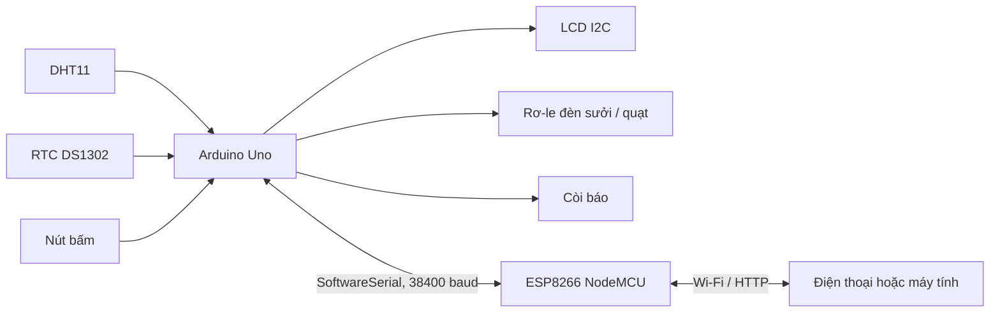

# Smart Egg Incubator

Hệ thống máy ấp trứng thông minh dùng **Arduino Uno** để đọc cảm biến và điều khiển thiết bị, kết hợp **ESP8266 NodeMCU** để cung cấp giao diện giám sát và điều khiển qua Wi-Fi.

> **Tình trạng:** Dự án dành cho mục đích học tập và thử nghiệm. Thiết bị chưa được chứng nhận để sử dụng như hệ thống ấp thương mại hoặc vận hành không giám sát.

## Tính năng

- Đọc nhiệt độ và độ ẩm bằng cảm biến DHT11.
- Tự động điều khiển đèn sưởi và quạt theo nhiệt độ/độ ẩm mục tiêu; có xử lý quá nhiệt.
- Theo dõi ngày ấp bằng đồng hồ thời gian thực DS1302 và tự chuyển giai đoạn theo hồ sơ.
- Hiển thị trạng thái trên LCD I2C 16×2 và phát còi xác nhận/cảnh báo.
- Chọn một trong sáu hồ sơ trứng dựng sẵn hoặc chế độ thử nghiệm:

| Hồ sơ | Tổng ngày | Bắt đầu cận nở |
| --- | ---: | ---: |
| Gà | 21 | 19 |
| Vịt | 28 | 25 |
| Cút | 17 | 15 |
| Bồ câu | 18 | 16 |
| Ngỗng | 30 | 27 |
| Chim trĩ | 24 | 21 |
| Thử nghiệm | 3 | 2 |

- Điều chỉnh hồ sơ, ngày ấp và trạng thái thiết bị bằng nút vật lý hoặc giao diện web.
- ESP8266 chạy web server, cấu hình Wi-Fi bằng WiFiManager và quảng bá tên mDNS `mayaptrung.local` khi mDNS hoạt động trên mạng.
- Giao diện web có chế độ sáng/tối; lựa chọn theme được lưu trong trình duyệt.

## Kiến trúc



Arduino Uno chịu trách nhiệm đọc cảm biến và quyết định điều khiển. ESP8266 xử lý kết nối Wi-Fi, web server và chuyển lệnh giao diện qua serial đến Uno. Hai bo trao đổi dữ liệu trạng thái theo gói văn bản; Uno hiện gửi dữ liệu sang ESP theo chu kỳ một giây.

## Phần cứng

| Thành phần | Kết nối trên Arduino Uno |
| --- | --- |
| DHT11 | D2 |
| Rơ-le quạt | D4 |
| Rơ-le đèn sưởi | D5 |
| Nút 1 / Nút 2 / Nút 3 | D6 / D7 / D8 |
| Còi | D9 |
| RTC DS1302 CLK / RST / DAT | D10 / D11 / D12 |
| LCD I2C | SDA / SCL (A4 / A5 trên Uno), địa chỉ `0x27` |
| Serial Uno nhận từ ESP | A0 |
| Serial Uno gửi đến ESP | A1 |
| ESP8266 nhận từ Uno | D5 |
| ESP8266 gửi đến Uno | D6 |

Nối chéo đường serial: **Uno A1 (TX) → ESP D5 (RX)** và **ESP D6 (TX) → Uno A0 (RX)**; nối chung GND giữa hai bo. Serial giữa hai vi điều khiển chạy ở **38400 baud**.

> **Lưu ý mức điện áp:** Uno hoạt động mức logic 5 V, ESP8266 dùng GPIO 3,3 V và không chịu được tín hiệu 5 V trực tiếp. Dùng mạch chuyển mức hoặc bộ chia áp phù hợp trên đường TX từ Uno sang RX của ESP8266. Kiểm tra sơ đồ module rơ-le và cảm biến trước khi cấp nguồn.

## Cấu trúc repository

```text
.
├── src/
│   ├── main.cpp       # Firmware Arduino Uno: cảm biến, RTC, LCD, rơ-le, nút và còi
│   ├── esp_main.cpp   # Firmware ESP8266: Wi-Fi, web server và serial bridge
│   └── web_page.h     # HTML/CSS/JavaScript nhúng vào firmware ESP8266
├── preview.html       # Bản xem trước giao diện web độc lập
├── platformio.ini     # Môi trường build PlatformIO cho Uno và ESP8266
├── HD_CHUCNANG.md     # Mô tả chức năng hệ thống
└── CAM_NANG_AP_TRUNG.md # Cẩm nang nghiệp vụ ấp trứng
```

Trang web được lưu trong `web_page.h`, biên dịch cùng `esp_main.cpp` và phục vụ từ flash của ESP8266; không cần triển khai một web server riêng.

## Yêu cầu phát triển

- Visual Studio Code với PlatformIO IDE, hoặc PlatformIO Core.
- Arduino Uno và NodeMCU ESP8266.
- Cáp USB truyền dữ liệu và driver USB-serial phù hợp với bo mạch.
- Cảm biến và linh kiện cần thiết theo bảng kết nối.

Các thư viện phụ thuộc được khai báo theo từng môi trường trong `platformio.ini` và PlatformIO sẽ cài khi build.

## Build và nạp firmware

Mở terminal tại thư mục repository. Hai môi trường được build độc lập:

```sh
pio run -e uno
pio run -e esp8266
```

Nạp firmware, thay `COMx` bằng cổng serial tương ứng với từng bo trên Windows:

```sh
pio run -e uno -t upload --upload-port COMx
pio run -e esp8266 -t upload --upload-port COMx
```

Trên Linux, dùng tên cổng tương ứng, ví dụ `/dev/ttyACM0` hoặc `/dev/ttyUSB0`. Có thể liệt kê thiết bị serial bằng:

```sh
pio device list
```

`platformio.ini` hiện có cổng ESP8266 được đặt cố định theo máy phát triển. Nếu cổng trên máy bạn khác, truyền `--upload-port` như trên hoặc sửa cấu hình cục bộ; không nên commit cổng riêng của máy vào repository dùng chung.

Sau khi thay đổi giao thức serial hoặc mã giao diện nhúng, build và nạp **cả hai bo nếu thay đổi ảnh hưởng đến hai phía**. ESP8266 nạp `esp_main.cpp`; Arduino Uno nạp `main.cpp`.

## Sử dụng

1. Cấp nguồn riêng phù hợp cho từng bo và kiểm tra nối chung GND/đường serial.
2. Khởi động hệ thống; ESP8266 kết nối Wi-Fi đã lưu hoặc mở WiFiManager config portal khi cần cấu hình.
3. Truy cập địa chỉ IP do ESP in ra Serial Monitor; trong mạng hỗ trợ mDNS, có thể thử `http://mayaptrung.local`.
4. Đăng nhập giao diện web theo cấu hình hiện tại trong firmware.
5. Theo dõi nhiệt độ, độ ẩm, ngày ấp, hồ sơ và trạng thái thiết bị. Có thể đổi hồ sơ, ngày ấp, theme hoặc gửi lệnh điều khiển từ web.

Serial Monitor của Uno dùng **9600 baud**; Serial Monitor của ESP8266 dùng **115200 baud**. Baud rate của SoftwareSerial liên kết hai bo là 38400 baud.

## Bảo mật và an toàn vận hành

- Trước khi public repository hoặc triển khai, thay thông tin đăng nhập web và thông tin truy cập AP đang được đặt trực tiếp trong firmware. Không đưa mật khẩu Wi-Fi cá nhân, token hoặc thông tin xác thực vào source, tài liệu, ảnh chụp hay lịch sử Git.
- Thông tin xác thực từng commit vẫn có thể xem trong lịch sử Git sau khi xóa khỏi file hiện tại. Nếu đã commit bí mật, hãy thu hồi/đổi bí mật đó; khi cần loại bỏ khỏi repository public, phải làm sạch lịch sử trước khi push.
- Giao diện hiện dùng HTTP trên mạng nội bộ. Không mở cổng thiết bị ra Internet và không dùng mạng Wi-Fi công cộng/không tin cậy để vận hành.
- Các thông số hồ sơ là giá trị mặc định tham khảo, không thay thế hướng dẫn của nhà cung cấp trứng hoặc theo dõi thực tế. Kiểm tra độc lập độ chính xác cảm biến và nhiệt độ tại vị trí trứng.
- Phần cứng hiện tại điều khiển nhiệt/quạt và giám sát; không có cơ cấu đảo trứng tự động. Người vận hành cần tự đảo trứng và châm nước/điều chỉnh độ ẩm theo quy trình phù hợp.
- Không để thiết bị hoạt động không giám sát khi chưa thử nghiệm đủ các tình huống mất điện, lỗi cảm biến, rơ-le dính và quá nhiệt. Điện lưới và đèn sưởi có nguy cơ điện giật/cháy; cần cách điện, cầu chì và vỏ bảo vệ thích hợp.

## Tài liệu

- [Hướng dẫn chức năng](HD_CHUCNANG.md)
- [Cẩm nang ấp trứng](CAM_NANG_AP_TRUNG.md)
